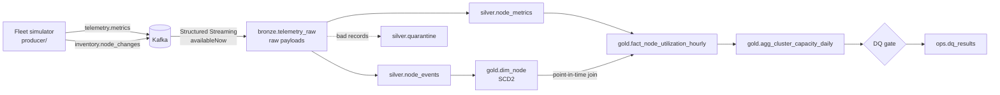

# Cloud Capacity Lakehouse

An end-to-end streaming lakehouse that ingests telemetry from a simulated fleet of database host nodes, cleans it, models it dimensionally, and flags clusters that are running out of capacity. Kafka → Spark Structured Streaming → Delta Lake (bronze/silver/gold) → Airflow, with data quality gates and CI.

The simulated fleet is 72 nodes across 9 clusters in 3 regions. The data is deliberately dirty: duplicate deliveries, events arriving up to 45 minutes late, truncated JSON, out-of-range values, missing keys, and a mid-stream schema change. Nodes also get resized, moved between clusters, and decommissioned, which is what drives the SCD Type 2 dimension.

## Architecture



Airflow runs the pipeline every 15 minutes (`dags/lakehouse_pipeline.py`) and a nightly OPTIMIZE / Z-ORDER / VACUUM job (`dags/lakehouse_maintenance.py`).

## Data model

| Table | Grain | Notes |
|---|---|---|
| `bronze.telemetry_raw` | one Kafka message | payload kept as a raw string; partitioned by `ingest_date` |
| `silver.node_metrics` | one event (`event_id`) | validated, deduplicated; partitioned by `event_date` |
| `silver.node_events` | one config snapshot | deduplicated history of node changes |
| `silver.quarantine` | one rejected record | reason code + original payload, for replay |
| `gold.dim_node` | one version of a node | SCD2 on cluster, region, SKU, vCores, memory, status |
| `gold.fact_node_utilization_hourly` | node × hour | avg/p95/max CPU and memory, `used_vcores_p95`, FK to `dim_node` |
| `gold.agg_cluster_capacity_daily` | cluster × day | p95 utilisation, headroom, `at_risk` / `healthy` / `underutilized` |

## Running it

You need Docker Desktop with about 6 GB of memory allocated.

```bash
# Linux only: run containers as your user so ./data stays writable
echo "AIRFLOW_UID=$(id -u)" > .env

make up          # kafka + topic setup + producer (6h backfill, then live) + airflow
make run-once    # run every job once, in order, without waiting for Airflow
make show        # print gold tables, SCD2 history, quarantine reasons, DQ results
```

Airflow is at http://localhost:8080 (user `admin`, password from `make password`). Unpause `lakehouse_pipeline` to let it run on schedule.

Tests run without Docker (Python 3.11 and Java 17):

```bash
pip install -r requirements-dev.txt
make test              # pure transform tests, including the full chain on 6 simulated hours
make test-integration  # Delta MERGE idempotency and incremental SCD2 against real Delta tables
```

## Design decisions

### Bronze stores raw strings, not parsed columns

Parsing happens in silver. A malformed message can't fail ingestion, and if parsing logic has a bug, silver can be rebuilt from bronze without going back to Kafka (whose retention is 7 days here).

### Streaming jobs run as `trigger(availableNow=True)`

Each Airflow run processes whatever arrived since the last checkpoint and stops. You get streaming's offset tracking and exactly-once commits without paying for an always-on cluster. `bronze_ingest --continuous` switches to 30-second micro-batches if lower latency is needed.

### Deduplication is a MERGE on `event_id`, not `dropDuplicates` with a watermark

A watermark only deduplicates within its time window and holds state in memory. An insert-only MERGE against the table is idempotent across batches, retries, and full replays of bronze, however late the duplicate shows up. The MERGE carries a literal `event_date IN (...)` predicate so Delta prunes the target to the partitions in the batch instead of scanning the whole table.

### Quarantine appends use `txnAppId`/`txnVersion`

`foreachBatch` gives at-least-once execution. If a batch fails after the quarantine write and gets retried, Delta sees the batch id was already committed and skips the duplicate append.

### Late data recomputes affected hours instead of appending

An event for 09:00 can arrive at 11:30. The fact job finds every hour touched by rows loaded since its watermark, recomputes those hours in full from silver, and MERGEs them over the existing rows. The watermark is `_silver_loaded_at` (when the row landed), not `event_ts` (when it happened). Watermarking on event time would silently skip late events.

### Watermark reads are pinned to one Delta version

Each gold job reads its source with `versionAsOf`, so the rows it processes and the watermark it records come from the same snapshot, and a concurrent commit can't slip between them.

### SCD2 rebuilds each affected node's full history

Rather than the textbook "expire the current row, insert a new one", the job takes every node with a new event, rebuilds that node's complete version history from silver, and swaps it in with one MERGE (update, insert, and `whenNotMatchedBySource` delete). Out-of-order events then land in the correct position automatically, which the textbook approach gets wrong. Repeated snapshots with no attribute change are collapsed by hashing the tracked columns.

### The fact-to-dimension join is point-in-time

Each node-hour is joined to the `dim_node` version in effect at that hour's last sample, so a node resized from 8 to 16 vCores reports capacity against 8 before the change and 16 after. Facts whose dimension row hasn't arrived yet are kept with a null `node_sk` (left join), counted by the DQ job, and recomputed on the next run so they heal once the dimension catches up.

### Failed quality checks stop the pipeline

`dq_checks` verifies uniqueness at every grain, value ranges, freshness, quarantine rate, orphan-fact rate, and SCD2 integrity (exactly one current version per node, no gaps or overlaps between versions). Results go to `ops.dq_results`. A failed critical check exits non-zero, which fails the Airflow task.

## What I'd change for production

On Azure Databricks: Event Hubs with its Kafka endpoint instead of self-hosted Kafka (the Kafka reader code doesn't change), Unity Catalog tables instead of paths, liquid clustering instead of partitioning plus Z-ORDER, and Databricks Workflows or Airflow's Databricks operators in place of `BashOperator`. `LAKEHOUSE_ROOT` accepts an `abfss://` path, so the jobs themselves port as-is.

At larger scale, the `IN (...)` literal lists used for partition pruning should be replaced with a join against a small staging table, and the hourly recompute should be bounded (late events older than N days go to a separate backfill path).

## Known limitations

The fleet is simulated, so volumes are small (about 4,300 metric events per simulated hour). The cluster-level p95 sums per-node p95s, which overstates the true cluster p95 because node peaks don't all coincide; that errs on the safe side for capacity planning, but it is an approximation. Airflow runs in standalone mode with SQLite and a sequential executor, which is fine for a demo and wrong for anything shared.

## Layout

```
producer/        fleet simulator + Kafka producer
lakehouse/
  transforms/    pure DataFrame logic (silver.py, gold.py), unit-tested
  jobs/          I/O wrappers: one module per pipeline step
  dq/            data quality checks
  delta_utils.py table bootstrap, pinned reads, watermark table
dags/            Airflow DAGs
tests/           unit + integration tests
```
